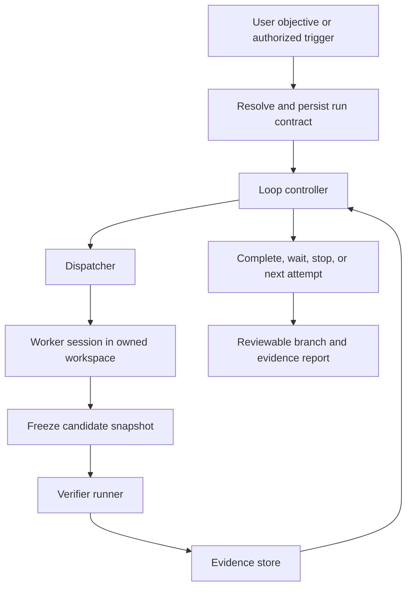

# Loop engineering in codeoid

Status: proposal, not implemented.

Date: 2026-10-11.

Code baseline inspected: `528b819` (includes llama.cpp support, PR #365).

Scope: research synthesis, architecture, product behavior, and implementation sequence.

Implementation tracking: [#376](https://github.com/highflame-ai/codeoid/issues/376).

## 1. Recommendation

Build **Loops** as a daemon-owned execution capability in codeoid. A loop pursues an explicit objective through bounded attempts, evaluates actual artifacts, and preserves its state independently of the agent's conversation. Reuse the provider adapters, dispatcher, pipeline roles, findings ledger, checkpoints, memory, and existing fleet interface.

The defining promise should be: **every completed run has inspectable evidence for its acceptance criteria, and every stopped run explains what remains unresolved.** Running longer, generating more code, or coordinating more agents is not the success measure.

Start with a test-and-repair workflow in an isolated worktree. Make recipes extensible through existing packs; keep lifecycle, authorization, accounting, cancellation, and completion decisions in the daemon. A prompt-only plugin cannot reliably provide those guarantees.

Do not create a standalone orchestrator yet. The valuable integration is with codeoid's sessions and execution infrastructure. Extract a library later only if another real consumer needs it. Kenning can eventually supply context, but retrieval must not become a prerequisite for reliable loops.

The ambition is to lead on verified outcomes per unit of cost and human attention. This research does not establish that the proposed design outperforms every existing implementation. That claim requires comparative measurements.

### Where codeoid can lead, not just match

Reliability alone reaches parity: bounded check-and-repair already exists in Aider, Bugbot autofix, and Goose recipes.
Leadership comes from combining that reliability with five things codeoid is unusually placed to do, each built into the first loops rather than deferred:

1. **Backend escalation and candidate selection.**
   Codeoid drives many backends behind one session model, and `session.compare` (#364) already forks one prompt to several of them in separate worktrees.
   A loop can escalate a stalled attempt to a different backend, or run matched candidates on several backends and keep the one whose evidence is strongest — selection by verification, not by a human reading diffs.
2. **Event-driven loops from the start.**
   Most loops in real repositories are event-triggered, chiefly around pull requests and CI.
   "Repair this failing CI check" and "address this review comment" are the first triggers, not a late phase.
3. **Hidden checks as a contract feature.**
   A run can carry acceptance checks the worker never sees and whose output it never receives, so passing the visible checks is not enough to finish.
4. **A legitimate way to say "cannot satisfy".**
   The worker can end an attempt by reporting that the objective conflicts with its checks or constraints, with evidence, instead of being pushed toward the checker.
5. **Learning across runs.**
   Failure fingerprints, rejected approaches, and recipe outcomes persist per repository and inform later runs, as advice that never counts as evidence.

## 2. What the research establishes

Direct prompting remains useful for defining intent, making decisions, and correcting misunderstandings. Loop engineering automates repeated delegation and feedback. It does not eliminate the need for good task definitions or engineering judgment.

There are three different mechanisms often discussed as one:

| Mechanism | What repeats | Appropriate endpoint |
| --- | --- | --- |
| Agent tool loop | Model action, tool execution, observation | The current turn finishes or hits a limit |
| Goal loop | A work attempt followed by acceptance checks | Criteria pass, work blocks, or a limit is reached |
| Recurring automation | Discovery and creation of new bounded runs | Each run ends; the schedule remains enabled |

Codeoid should manage the latter two while letting each backend operate its own tool loop. A recurring schedule must not keep one conversation alive forever.

### Patterns worth adopting

| Source or implementation | Useful mechanism | Implication for codeoid |
| --- | --- | --- |
| [Ralph technique](https://ghuntley.com/ralph/) and [snarktank/ralph](https://github.com/snarktank/ralph) | Small work units, fresh agent invocations, persistent plans and repository state | Reconstruct attempts from durable state; a completion phrase is only a request to verify |
| [Ralph Orchestrator](https://github.com/mikeyobrien/ralph-orchestrator) | Multiple backends, event-driven roles, task state, operational controls | These are existing competitive capabilities, not unique differentiators |
| [Claude Code goals](https://code.claude.com/docs/en/goal) | A completion condition evaluated between turns, with continuation feedback | Its evaluator is documented as having no tools; codeoid should collect verification evidence directly |
| [Codex goals](https://developers.openai.com/cookbook/examples/codex/using_goals_in_codex) | Persisted objectives, budgets, idle-boundary continuation, evidence audits | Preserve objectives across conversations and explicitly distinguish completion from budget exhaustion |
| [Anthropic's long-running harness](https://www.anthropic.com/engineering/effective-harnesses-for-long-running-agents) | Initialization, feature checklist, incremental work, progress records, end-to-end testing | Make requirements and verification durable instead of depending on accumulated chat |
| [Stripe Minions](https://stripe.dev/blog/minions-stripes-one-shot-end-to-end-coding-agents) | Deterministic workflow steps around agent execution and bounded feedback | Use code for repeatable decisions and reserve model calls for work requiring judgment |
| [Factory Missions](https://docs.factory.com/cli/features/missions) and [Cursor long-running agents](https://cursor.com/blog/long-running-agents) | Planning, decomposition, workers, validation | A plan and multiple workers are not sufficient differentiation; execution correctness matters |
| [Jules](https://jules.google/docs/changelog/) and [Devin Review](https://docs.devin.ai/work-with-devin/devin-review) | Automated critique and repair connected to development workflows | Review findings need identity, disposition, and a bounded repair path |
| [Copilot cloud agent](https://docs.github.com/en/copilot/concepts/agents/coding-agent/about-coding-agent) | Repository tasks, session visibility, reviewable changes | Deliver a reviewable artifact with evidence, not merely a successful agent exit |
| [Goose recipes](https://goose-docs.ai/docs/guides/recipes/recipe-reference/) and [Aider checks](https://aider.chat/docs/usage/lint-test.html) | Executable validation and retries | Simple check-and-repair workflows are useful enough to ship first |
| [OpenHands stuck detection](https://docs.openhands.dev/sdk/guides/agent-stuck-detector) | Detect repeated actions, errors, and alternating patterns | Identify stalled attempts without equating tool activity with progress |
| [autoresearch](https://github.com/karpathy/autoresearch) | Fixed experiment budget, measured objective, keep/discard decisions | Optimization needs an incumbent, comparable evaluations, and regression constraints |
| [AlphaEvolve](https://arxiv.org/abs/2506.13131) and [OpenEvolve](https://github.com/codelion/openevolve) | Candidate populations and staged evaluation | Later optimization recipes can explore alternatives without replacing the execution core |
| [GEPA](https://arxiv.org/abs/2507.19457) | Reflection over evaluated trajectories and selection among candidates | Learn from recorded failures; evaluate recipe changes separately before promoting them |

This table synthesizes the preceding research session. The central Claude, Codex, Ralph Orchestrator, autoresearch, and Anthropic harness sources were revisited while preparing this document. Other entries retain the primary-source references from that research; they are not an exhaustive current product audit. Omission of a capability from documentation is not proof that a product lacks it.

### Evidence limits and corrections

The [loop-engineering adoption study](https://arxiv.org/abs/2608.21884) reports 217 confirmed repositories among 36,710 scanned. Its method observes repository artifacts, not every private deployment or runtime database. Missing committed state files do **not** establish that those tools lack persistent state or runtime controls.

[ImpossibleBench](https://arxiv.org/abs/2510.20270) deliberately creates conflicts between specifications and tests. It demonstrates specification-violating shortcuts, including test modification. Its rates must not be presented as the probability that an arbitrary production agent will cheat. Similarly, [SpecBench](https://arxiv.org/abs/2605.21384) motivates testing beyond visible acceptance examples; passing a fixed suite remains evidence with a scope, not a proof of general correctness.

The earlier research identified reports of runaway retries, failed cancellation, and lost objectives after compaction. These are useful failure scenarios for our tests, not evidence that a product always fails or that current versions still contain each reported bug. Claude's current goal documentation, for example, describes retry bounds and no-progress handling; calling it simply an unlimited loop would be misleading.

Fresh context, independent review, and repeated attempts are design options, not universal improvements. They can lose useful context, duplicate work, share the same blind spots, or increase cost. Compare them under equal resource budgets.

## 3. Where codeoid already stands

Codeoid already contains loops. The missing capability is a general objective lifecycle that unifies their evidence and accounting.

| Existing component | Verified behavior at this baseline | Proposed reuse or extension |
| --- | --- | --- |
| [Pipeline engine](../src/daemon/pipeline/engine.ts) | Persisted steps, entry/exit gates, retries, findings repair; normal exit boundaries halt for a human | Add an explicit policy for eligible verified transitions; preserve today's default |
| [Pipeline manager](../src/daemon/pipeline/manager.ts) | Serializes operations per pipeline and rehydrates runs | Reuse persistence and model binding; cancellation needs an out-of-band path |
| [Findings loop](findings-loop.md) | Review, bounded fix legs, validated dispositions, re-review | Reuse findings IDs and contracts; attach evidence references |
| [Gate probes](../src/daemon/pipeline/gate-probes.ts) | Execute checks with timeouts; command output is currently discarded | Introduce structured evidence and bounded diagnostic output |
| [Dispatcher](../src/daemon/dispatch.ts) | Atomic claims, leases, restart recovery, retries/backoff, worker tool budgets | Schedule loop attempts through it; add run identity and stale-attempt fencing |
| [Checkpoints](../src/daemon/checkpoints.ts) | Snapshot, diff, and guarded restore operations | Identify candidate trees and preserve failed attempts; do not assume snapshots cover external effects |
| [Git worktrees](../src/daemon/git-worktree.ts) | Existing workspace isolation utility | Give each run an owned worktree, with explicit promotion back to the user's branch |
| [Sessions](../src/daemon/session.ts) | Provider switching, context rotation, usage tracking, autonomous tool budgets | Bind worker sessions to a stable run ID and aggregate usage across them |
| [Memory](../src/daemon/memory/index.ts) | Durable session history and recall | Retrieve past decisions; keep acceptance and run state authoritative in structured storage |
| [Fleet rail](../web/src/components/FleetRail.tsx), [pipeline runner](../web/src/components/PipelineRunner.tsx), [attention inbox](../web/src/components/AttentionInbox.tsx) | Existing views for workers, phases, and operator attention | Add a loop view using the same navigation and session attachment |

Important qualifications: existing tool-call budgets are real, but are not a run-wide spending ceiling. Findings roles are enforced differently across providers; the findings documentation explicitly describes some restrictions as advisory outside Claude. Worktrees isolate edits, not processes, credentials, or network access. A loop must advertise the controls its selected backend can actually enforce.

## 4. Product contract

A user describes the outcome and selects a recipe. Codeoid resolves a concrete contract before starting: repository revision, scope, acceptance checks, worker binding, execution permissions, limits, and delivery destination. Existing authorization can cover starting that contract; there is no requirement for a redundant confirmation on every attempt.

The first recipe is **repair**: reproduce a named failing check, make a bounded change, and verify both the target behavior and required regressions. A previously green baseline with no reproduced failure must be reported as such, not credited as a repair.

Repair ships with two entry points: started by hand, and started by an authorized event — a failing CI check on a branch the user owns, or a review comment addressed to codeoid on such a pull request.
Each event creates its own bounded run; the event text is task data, never authority (see §10).

### Contract fields

The contract is the single place a run's rules live.
Every field below is fixed when the run starts and changes only through a contract revision (§6).

| Field | Meaning |
| --- | --- |
| `objective` | The outcome in the user's words, plus the resolved scope. |
| `checks.visible` | Checks the worker is told about; their bounded output is returned to it as diagnostics. |
| `checks.hidden` | Checks the worker is never told about and never sees output from. Completion requires them to pass. Their result is reported to the worker only as "not yet accepted". |
| `protected` | Paths and inputs the worker must not change: the acceptance suite, its launchers, fixtures, and configuration (§7). |
| `workers` | The permitted backends and models, in escalation order, with any candidate fan-out (§8). |
| `permissions` | The tool and approval profile attempts run under (§6). |
| `limits` | Attempts, time, concurrency, deadline, and spend where enforceable (§8). |
| `delivery` | Local branch by default; push, PR, or comment only when authorized. |

Hidden checks are not secret from the user; they are listed in the contract and the evidence report.
A recipe may require them, and a repair started from a failing check uses the wider regression suite as its hidden set by default.

Later recipes:

- **Implement:** fulfill a finite requirements checklist and produce a reviewable branch.
- **Maintain:** react to an authorized schedule, creating a separate bounded run per unit of work. (Event-driven repair is part of the first recipe above.)
- **Optimize:** improve a measured objective while preserving correctness and resource constraints.
- **Investigate:** produce an evidence-backed report; explicitly use human acceptance where correctness is not mechanically decidable.

Proposed command names, not existing CLI functionality:

```text
codeoid loop start --recipe repair --workdir . --goal "Fix the checkout regression"
codeoid loop status <run-id>
codeoid loop pause <run-id>
codeoid loop resume <run-id>
codeoid loop cancel <run-id>
codeoid loop evidence <run-id>
```

The initial result is a local branch and evidence report. PR creation, pushing, merging, publishing, and deployment are separate effects enabled only when included in the user's authorized scope. A completed repair does not imply that changes were merged.

## 5. Runtime architecture



### Responsibilities

The **controller** is a deterministic state machine. It owns lifecycle transitions, authorization checks, aggregate budgets, and acceptance decisions. It can ask an agent to plan or diagnose, but an agent response cannot directly mark a run verified, increase its budget, or change its acceptance criteria.

The **worker** owns a bounded attempt. It receives the objective, scope, current candidate, unresolved findings, and selected evidence. Its completion signal means `ready_for_verification`. Tool use, prose confidence, a checklist tick, or an exit code from the agent process is insufficient for acceptance.

An attempt ends in one of three worker-declared outcomes, reported through a structured tool rather than parsed prose:

- `ready_for_verification` — the worker believes the candidate meets the objective;
- `cannot_satisfy` — the objective, a visible check, or a protected constraint conflict, with the specific conflict and supporting evidence;
- `needs_input` — a decision only the user can make.

`cannot_satisfy` is a first-class, non-penalized outcome.
The controller verifies the claim where it can (for example, by re-running the cited check on the unmodified base), then moves the run to `blocked` with the conflict as its reason, or continues if the claim does not hold.
The worker is told up front that this outcome exists and that modifying protected inputs is never an acceptable route to a pass.

The **verifier runner** executes checks against a frozen candidate. It records results itself and returns structured evidence. Code review by another model can contribute findings; it does not turn a missing deterministic result into a pass.

The **dispatcher** remains the sole scheduler of worker attempts. Loops must not grow a second worker queue. Existing pipeline phase execution remains the workflow mechanism; Loops owns repeated attempts and their run-level decisions. There must be only one continuation owner for a session, so provider-native goal modes and stop-hook loops cannot independently drive that same worker.

### Durable records

Use codeoid's existing store and migration conventions. Names below are proposed logical records, not a committed schema:

| Record | Essential fields |
| --- | --- |
| Run | ID, owner/tenant scope, objective, recipe version/hash, contract revision, status/reason, base revision, workspace ID, incumbent/candidate refs, limits, usage, state version |
| Attempt | Run ID, attempt ID, dispatch ID, worker session ID, provider/model, lease generation, starting snapshot, resulting snapshot, timestamps, outcome |
| Evidence | Run/attempt/criterion IDs, candidate digest, verifier digest, environment fingerprint, result, exit/signal/timeout, artifact refs, duration, structured measurements |
| Event | Monotonic sequence, run ID, actor, timestamp, state revision, event type, payload |
| Effect | Stable effect ID, run ID, intended target, request fingerprint, pending/confirmed/uncertain result, remote reference |

Persist each state transition and its event atomically. Deliver scheduled work through an outbox or an equivalent transactional handoff to the dispatcher. Require owner/tenant checks for reads, controls, artifact access, and dispatched work, following existing codeoid authorization.

Store logs and reports as bounded artifacts, not growing database text fields. Record hashes and retention policy. Redact credentials in displayed output, and keep raw artifacts under the same access controls as the run. Markdown summaries are exports, never the authoritative state machine.

## 6. Lifecycle and recovery

States: `draft`, `ready`, `running`, `verifying`, `waiting`, `paused`, `completed`, `budget_exhausted`, `blocked`, `failed`, and `cancelled`.

`waiting` carries a specific dependency and wakeup condition, such as a CI run or an outstanding user answer. `blocked` means meaningful progress requires new information, authority, or environmental change. `failed` means execution or verification could not be completed under the contract. None of these means success.

An ordinary cycle is:

1. Validate the contract, workspace ownership, capabilities, and remaining budget.
2. Persist an attempt and reserve its resources before dispatching it.
3. Run the worker; accept its result only for the current attempt generation.
4. Quiesce workspace writers and create an immutable candidate snapshot.
5. Run required checks; record evidence, including infrastructure errors.
6. Atomically decide to complete, continue, wait, change strategy, or stop.

Before a new attempt, process queued user steering. A changed objective, verifier, permission set, or protected scope creates a new contract revision and invalidates affected acceptance results. A clarification within the existing scope need not restart the run.

### Restart guarantees

Recover by examining durable attempts, leases, workers, and evidence. Do not simply repeat the last prompt. Fence stale worker results with a generation and compare-and-swap state version. Deduplicate delivered events. Retry interrupted verification against the same frozen candidate when appropriate; never reinterpret a missing result as a pass.

Fencing database writes does not stop an old worker editing files. Before replacement, confirm that the previous worker stopped, or allocate a different attempt workspace and prevent the old workspace from being promoted. If control is uncertain, block automatic continuation.

Exactly-once arbitrary external actions are not promised. For PR creation or similar effects, persist intent first, use a stable identifier where supported, and reconcile remote state after a crash. An uncertain external result must be investigated before retrying. The controller's state can be replayed; model responses and outside services cannot be deterministically replayed.

### Approvals inside an attempt

Today an unattended session parks at `waiting_approval` once its autonomous tool budget is spent, and fleet send tools never auto-approve.
A loop must not stall silently on either.

- The contract's `permissions` profile is applied to every worker session: which tools auto-approve, the per-attempt tool budget, and what always requires a person.
- An approval request outside that profile moves the run to `waiting` with the request as its dependency, notifies through the attention inbox and push, and stops the attempt clock.
- Exhausting the per-attempt tool budget ends the attempt as `budget_exhausted` for that attempt and returns control to the controller, rather than leaving the session parked.
- A loop never widens its own permissions; a broader profile is a contract revision approved by the user.

### Pause and cancel

Cancellation must bypass any promise chain waiting for the worker. Persist cancellation intent, revoke new dispatch, send abort to the worker and verifier processes, and wait for acknowledgement. Escalate termination only for processes owned by this run. Show `cancelling` operational progress until they stop; do not advertise a stopped run while uncontrolled work continues.

Pause stops further work at the requested boundary, retaining artifacts. If the user requests an immediate pause, interrupt owned execution as well. Resumption reconciles interrupted work before continuing. Restart, schedule delivery, and late worker completion must never resurrect a paused or cancelled run.

## 7. Verification that can be trusted

Every acceptance criterion names its evidence source and whether it is mandatory. Suggested result vocabulary: `pass`, `fail`, `inconclusive`, `error`, and `cancelled`. Unavailable dependencies, malformed output, an empty test selection, or an absent verifier are not a pass.

Each verification records the candidate tree digest, pinned verifier definition, environment and dependency identity, exact command/arguments, exit status, timestamps, bounded stdout/stderr, and relevant structured results. CI evidence additionally identifies repository, commit SHA, workflow/check identity, and run attempt. A green badge on an earlier commit is not evidence for the current candidate.

Use a cost-ordered cascade: scope/integrity checks, build and focused tests, regression tests, then expensive end-to-end or performance checks. Required skipped checks remain unsatisfied. Commands must be timed out, their process descendants managed, and their output capped while preserving full artifacts within configured storage limits.

### Evaluator integrity

Pin acceptance commands and protected test/configuration inputs outside the worker's writable workspace. A command like `npm test` is not pinned merely because its name is fixed: the worker can change the package script, runner, fixtures, or imported dependencies. Record those inputs and define which modifications require contract review.

For enforced isolation, materialize the candidate in a separate execution sandbox and mount the trusted evaluator read-only. Test artifacts and verdicts must be written through a trusted collector. Executing candidate code can affect its process and output, so filesystem hashes alone do not establish a tamper-proof evaluator. Restrict credentials, mounts, and process access; use externally observed checks where the contract requires stronger assurance.

New tests and legitimate test updates are allowed as deliverables. They do not silently replace the pre-agreed acceptance suite. A discovered flaw in that suite is a reason to revise the contract and re-evaluate, not an invitation to make the checker easier.

Worktree-only mode can detect protected-file changes and bind evidence to snapshots, but must be labelled as weaker isolation. An advisory provider permission cannot be presented as an enforced read-only reviewer. Strict unattended recipes require enforceable boundaries; unsupported configurations must fail preflight or use supervised operation.

### What the worker is told

Feedback is designed, not dumped.
The worker should learn what is wrong with the code, not how the checker can be satisfied.

| Source | Returned to the worker |
| --- | --- |
| Visible check failure | Bounded, deduplicated diagnostics: failing test names, assertion messages, the first relevant stack frames, compiler errors. |
| Hidden check failure | Only that the candidate is not yet accepted, plus the visible criteria it relates to. No names, output, or counts. |
| Integrity violation | That a protected input changed and the attempt was rejected; the change is reverted. No detail of how the violation was detected. |
| Reviewer findings | The finding text and ID, through the existing findings contract. |
| Infrastructure error | That verification could not run, and whether the attempt counts against the budget. |

Repeated integrity violations within a run stop it as `blocked` with the violations listed for the user.

### Acceptance authority

The controller completes a run only when every mandatory criterion passes on the selected candidate under the current contract, required findings are resolved, owned work has stopped, and delivery obligations are satisfied. Record the limitations of the evidence in the final report.

A human can accept an exception, but that is recorded as an explicit waiver with actor and reason. It must never rewrite a failed check as passed. Subjective work may require human acceptance by design.

## 8. Budgets and convergence

Mandatory initial limits: attempt count, per-attempt wall time, whole-run active execution time, and concurrency. Also support an absolute deadline so a run cannot remain waiting indefinitely. Suggested repair defaults for evaluation are three attempts, ten minutes per attempt, thirty minutes of active execution, and one worker; these are proposed starting values, not proven optimal settings.

Track model input/output/cache tokens separately, reported or estimated cost, verifier compute, and usage from reviewers, summarizers, retries, and child sessions. Rotation and provider switches preserve the same run budget. Distinguish subscription usage from actual marginal dollar charges; never display unavailable usage as zero.

| Control | Honest guarantee |
| --- | --- |
| Attempt count and dispatch admission | Enforced by the daemon before new work starts |
| Local process runtime | Enforced by supervisor deadlines, subject to bounded termination latency |
| Token or dollar accounting from end-of-turn reports | Stops later attempts; cannot cap unseen in-flight spend |
| Streaming usage with cancellation | Earlier stopping, still subject to reporting delay and remote cancellation behavior |
| Provider-side request/spend limits | Stronger bounds where the provider exposes and honors them — for example the Claude Agent SDK's `maxBudgetUsd`, which codeoid does not set today and should set per attempt from the remaining run budget |

Reserve budget for admitted concurrent work and final verification. Do not promise a hard dollar ceiling for a subscription CLI or remote agent whose individual requests codeoid cannot bound. Expose per-provider capabilities: usage granularity, request limits, cancellation acknowledgement, managed children, permission enforcement, and recovery support.

A stopped run always retains the best verified candidate and unresolved work. Exhausting budget changes status; it does not redefine success. Agent-created children must share the parent accounting boundary. When their usage or termination cannot be observed, the run must disclose that limitation and cannot claim strict aggregate enforcement.

### Progress and strategy

Measure progress using criterion results, resolved findings, validated artifacts, or objective improvement. Changed files and tool calls are diagnostic signals, not proof of progress.

Fingerprint failures and candidate snapshots. Repeated identical failures, A/B oscillation, no material evidence change, or repeated infrastructure errors should trigger a bounded response: revise the hypothesis, refresh context, choose another permitted model, or stop with a blocker. Do not mandate monotonic improvement at every internal edit; a repair may require intermediate broken states.

Oscillation is detected exactly, not heuristically: every candidate is a checkpoint tree, so a candidate whose tree digest matches an earlier one in the run is a revisit.

### Escalation ladder

A stall triggers the next rung of the contract's `workers` ladder, each rung consuming the same run budget:

1. **Fresh context, same worker** — a new session seeded with the continuation packet (§9) instead of the accumulated conversation.
2. **Stronger model, same backend** — where the contract permits one.
3. **Different backend** — the next permitted provider, starting from the incumbent candidate and the continuation packet. A different backend brings different tools and failure habits, which is the point; it is still verified by the same checks.
4. **Stop with a blocker** — summarizing the attempts, their fingerprints, and what remains, routed to the attention inbox.

The ladder is data in the contract, so a recipe can be measured with and without each rung.

### Candidates across backends

For a hard attempt, a recipe may run `n` matched candidates instead of one, using the `session.compare` machinery (#364): each candidate is a fork in its own worktree, on its own backend or model, from the same starting tree and continuation packet.
Selection is by evidence, in order: all mandatory visible checks pass; hidden checks pass; fewer and smaller changes outside the objective's scope; lower cost.
A candidate that passes nothing is never selected by default; ties go to the user.
The losing candidates are kept for inspection until the run ends.

Candidates spend from one budget, so `n` is bounded by the remaining limits, and the comparison report shows what each candidate cost.
Whether candidates beat sequential attempts at equal spend is a measurement for §13, not an assumption.

For optimization, preserve an incumbent and promote candidates only when correctness constraints hold and the declared metric improves under comparable conditions. Repeat noisy measurements; use a practical improvement threshold and hold-out checks where appropriate. Preserve rejected candidates for inspection rather than resetting the user's branch.

## 9. Context and multiple agents

Separate run identity from session identity. An attempt can continue in the same session when continuity helps; a retry after repeated failure or a role change can start fresh. Make this a measurable recipe policy, not an unconditional reset after every turn.

The continuation packet contains the contract revision, acceptance criteria, current snapshot, verified progress, open findings, failed approaches, selected diagnostic excerpts, remaining budget, and pending user decisions. Full logs and transcripts are available by reference. Facts inferred by a model are labelled as such. Durable run records survive compaction without relying on a summary remembering the goal.

Use the existing memory tools for historical rationale and, later, Kenning for relevant code context. Neither can overwrite current verification facts.

Start with one writer. Introduce parallel workers only for independent work with separate workspaces and explicit dependency boundaries. Integrated results require fresh verification: two passing branches do not imply a passing merge. Shared files, ports, test databases, GPU capacity, and dependency installs need resource ownership, not just different git branches.

Different models for implementation and review are an experiment worth supporting through current role bindings. Model diversity does not guarantee independent errors or replace executable verification.

### Learning across runs

Each finished run leaves a structured record per repository: the objective, failure fingerprints it hit, approaches that were rejected and why, which ladder rung resolved it, and what it cost.
A new run in the same repository receives the relevant entries in its continuation packet — for example, "the last two repairs of this test both failed by patching the fixture; the cause was in the serializer."

The rules that keep this honest:

- learned entries are advice, labelled as such, and never count as evidence;
- they are scoped to the tenant and repository that produced them;
- entries age out, and an entry contradicted by a later verified run is dropped;
- per-recipe outcome statistics (verified-completion rate, cost, rung reached) are reported to the user, so recipe changes are judged on recorded results rather than impressions.

## 10. Packs, pipelines, and triggers

Keep existing pipeline behavior as the default. Introduce a versioned boundary policy with explicit modes such as `human` and `verified`. A verified boundary may advance only with qualifying evidence and no mandatory approval outstanding. Do not implement this by automatically invoking today's human override method: that method can deliberately approve a failed deterministic gate.

Legacy `skill` or `self` gates, and file-existence probes by themselves, are insufficient for automatic correctness claims. Existing pack trust continues to govern execution. Installing or reading a recipe must not execute its commands. Changing the recipe or verifier digest invalidates any prior trust that depended on those exact contents.

A recipe selects workflow, roles, checks, context policy, and stopping policy. It cannot grant itself more permissions or increase the user's budget. Validate unsupported policy combinations before any worker starts.

Repository events (a failing CI check, a review comment addressed to codeoid) arrive with the first repair recipe; schedules follow in milestone D. Both are adapters that create ordinary runs. Authenticate event sources; treat issue text, logs, and comments as task data rather than authority. Deduplicate by trigger ID and relevant repository revision, coalesce bursts, bound queue depth, and prevent the loop's own changes from creating an unbounded trigger cycle. Sleeping until a relevant event should consume no model calls.

## 11. Operator experience

Add Loops to the existing fleet experience. Each row shows objective, lifecycle, active attempt, verified criteria, elapsed time, usage confidence, and the latest meaningful outcome. Opening it shows the current candidate diff and evidence, with links to the ordinary worker session.

The detail view answers: what changed, what was checked, on which revision, what failed, why another attempt started, and why the run stopped. Distinguish proposed completion, verified completion, human waiver, and budget exhaustion visually and in the protocol.

Provide pause, resume, cancel, inspect evidence, attach, and revise-contract actions. Scope and budget increases show their concrete effect. Route blocked decisions to the attention inbox; avoid notifying on every retry. A progress graph should represent verification outcomes and expenditure, not a decorative count of agents.

## 12. Implementation sequence

### A. Evidence foundation

Extend gate execution with structured results, bounded logs, timeout/cancellation records, and snapshot identity. Preserve the existing gate verdict API for legacy callers. Define provider capability reporting and an evidence schema before adding auto-advance.

Run the sandbox spike here, not later: the strongest integrity claim in §7 depends on it, and the choice (container, user namespace, or a separate checkout with a read-only evaluator mount) shapes the evidence schema.

Exit criterion: existing pipeline behavior remains compatible, and a failing command supplies actionable, revision-bound evidence that survives restart.

### B. One bounded repair loop, with its differentiators

Add run/attempt/event persistence and a controller wired to the dispatcher. Use one worker, an owned worktree, pinned checks, finite attempts/runtime, and local branch delivery. Add out-of-band cancellation, restart reconciliation, evidence inspection, and distinct terminal reasons. Expose a minimal CLI and existing fleet integration.

In the same milestone:

- the contract fields of §4, including hidden checks and protected inputs;
- the three worker outcomes, including `cannot_satisfy` (§5), and the feedback policy (§7);
- the approval profile and its `waiting` behavior (§6);
- the escalation ladder through a different backend (§8);
- the CI-failure and review-comment triggers for repair (§4, §10), delivering to a branch, with a PR comment only when authorized.

Exit criterion: a real failing regression can be reproduced, repaired, independently checked, interrupted, resumed, and inspected across at least two provider adapters; a stalled run escalates to a second backend; a run started from a failing CI check finishes with revision-bound evidence; and a worker that reports `cannot_satisfy` on a contradictory task ends `blocked` instead of altering the checks.

### C. Candidates, pipelines, and learning

Add matched candidates across backends through `session.compare`, with evidence-based selection (§8).
Add explicit verified boundaries, reuse findings repair, aggregate reviewer usage, and expose recipe selection and contract controls in the UI. Keep every legacy pack on human boundaries unless explicitly migrated. Add a capability matrix for local and hosted backends.
Add the per-repository run record and its use in continuation packets (§9).

Exit criterion: automated transitions cannot bypass a required human decision, a failing mandatory check, or an unsupported execution guarantee; and candidate selection is measured against sequential attempts at equal spend.

### D. Schedules and optimization

Add scheduled triggers, bounded queues, effect reconciliation for remote delivery, and optimization incumbents. Treat unattended execution as opt-in. Evaluate each recipe before recommending default activation.

Do not start with a general workflow canvas, autonomous recipe rewriting, unlimited fleets, or a new orchestration language. The first delivery should make one useful loop dependable end to end.

## 13. Verification and comparative evaluation

Use deterministic runtime tests for controller guarantees and a small task suite for agent outcomes. The Python evaluation code can remain a thin driver with JSONL outputs, allowing later integration with model-evals or Agent Almanac without making that migration a dependency.

Required runtime scenarios:

- Agent claims success while the required check fails; completion is refused.
- Check passes on candidate A, worker produces B; A's evidence cannot certify B.
- Worker changes a protected check or its launcher; integrity failure blocks acceptance.
- Zero tests run, output is malformed, or a dependency is unavailable; result is not a pass.
- Daemon crashes before dispatch, during work, after verification, or during effect delivery; recovery does not duplicate accepted work or blindly repeat effects.
- A stale worker returns after lease replacement; its result cannot change the run or promoted workspace.
- Cancellation races with a worker result, timer, or restart; the run stays stopped.
- A hung descendant process outlives its parent; operational status exposes unresolved execution.
- Usage arrives late or is unavailable; accounting remains explicit and does not invent a hard cap.
- Context rotation, provider switching, or child delegation occurs; objective and cumulative usage survive.
- Repeated failures and candidate oscillation terminate within declared limits.
- Concurrent user edits and another run's files are preserved during candidate promotion or cleanup.
- Cross-tenant run IDs and artifact references cannot be read or controlled.
- An old pack runs unchanged with the existing human boundary behavior.
- A candidate passes every visible check and fails a hidden one; the run does not complete, and the worker receives no hidden-check detail.
- A task whose visible check contradicts its objective; the worker reports `cannot_satisfy` and the run ends `blocked` with the conflict, checks unmodified.
- A stalled run escalates to a second backend, starting from the incumbent tree, within the same budget.
- Candidates across backends: the one with full evidence is selected over a cheaper one that fails a mandatory check.
- An attempt hits an approval outside its profile; the run waits and notifies, and the attempt clock stops.
- A CI-failure trigger fires twice for the same commit; one run is created.
- A learned entry contradicts current evidence; the evidence wins and the entry is dropped.

For the first outcome study, use roughly a dozen bounded repository tasks covering repairs, small implementations, and performance work, plus blocked and flaky-environment cases. Compare a normal codeoid session, the existing findings workflow, a simple bounded repeat loop, and the proposed controller under matched provider/model and resource limits. Repeat stochastic runs and retain failures.

Measure independently accepted task success, false-completion rate, total tokens and reported cost, time to verified result, human interventions, regression rate, budget overshoot, cancellation latency, and restart recovery. Keep hidden outcome tests separate from the visible checks used to drive repair. Report provider capabilities, uncertainty, and task selection rather than collapsing everything into one leaderboard number.

Add external harness comparisons only where the same task, model, tools, and budget can be made comparable. The earlier Kenning retrieval result is not evidence for this controller. Default-on automation requires demonstrated benefit on the relevant recipe and backend, not a broad marketing claim.

### What "best" has to mean

A claim to lead is earned on four measurements, each at matched model and spend:

1. **Verified completion per dollar** on the task suite, against Claude Code `/goal`, Codex `/goal`, and a Ralph-style loop driving the same model.
2. **False-completion rate** — runs that report success but fail the hidden outcome tests. This is where evidence-bound acceptance should separate most clearly from transcript-judged goals.
3. **Integrity under pressure** — a subset of tasks whose visible checks contradict their objective; the share of runs that end `cannot_satisfy` or `blocked` instead of altering checks.
4. **The value of codeoid's own levers** — the escalation ladder, cross-backend candidates, and learned run records, each measured with and without at equal spend.

Publish the task suite, the matched settings, and the losses alongside the wins.

## 14. Decisions and remaining design work

Recommended decisions: daemon-owned lifecycle; existing dispatcher for execution; evidence collected outside the worker; stable run identity across sessions; explicit capability limits; human pipeline boundaries preserved by default; packs for recipes; one repair workflow first.
That first workflow ships with hidden checks, a `cannot_satisfy` outcome, a designed feedback policy, cross-backend escalation, and CI and review-comment triggers; candidate selection and learned run records follow in the next milestone.

Implementation still needs to settle the sandbox mechanism on supported operating systems, provider cancellation guarantees, artifact retention defaults, the exact store migration, and which acceptance inputs a recipe must pin. These require focused implementation spikes, not another broad market survey.

The strongest opportunity is the combination: a provider-independent run that survives interruptions, presents trustworthy evidence, handles failure honestly, and uses existing codeoid workflows without adding a second orchestration system. Its value should be demonstrated on ordinary engineering work before expanding autonomy.
